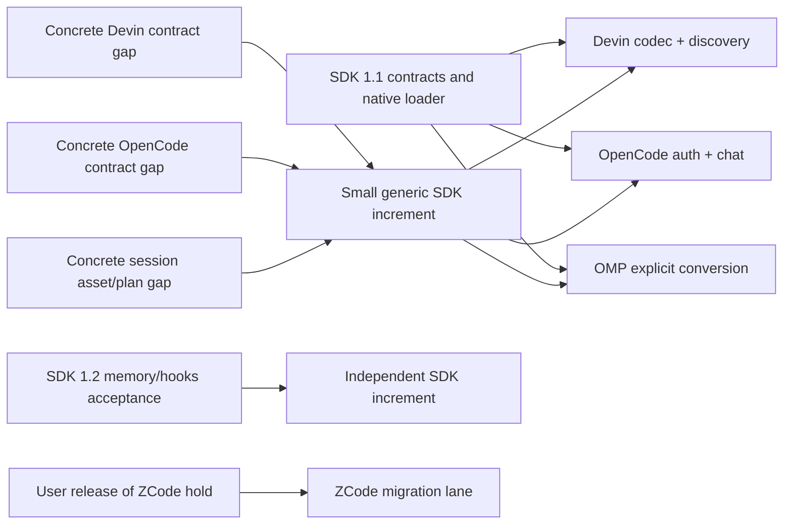

# Deliver our plugins alongside the SDK

Date: 2026-11-13

This plan follows the user's request to begin useful plugin implementation
before completing unrelated SDK surfaces. The coverage census remains the
backlog; it is not a sequential prerequisite for every module.

## Current bases and workspaces

- SDK API 1.1 is committed locally at `b3055364`, with its
  [scoped validation record](../adr/0005-native-composite-validation.md).
  It has not been published by this work.
- API 1.2 gateway hooks/private tools are committed locally at `e9831f37d`.
  The [validation record](../adr/0006-gateway-hooks-validation.md) distinguishes
  immutable aggregate tree `7e2a72b6178eb2a51c4e6018ee9515fdbb321da7` from the
  reviewed generation-authorization follow-up. These features are not
  prerequisites for the first three module slices below.
- The generic HTTP rejection/cancellation correction at `3f213a6d6`
  unblocks Devin's existing codec status contract without adding vendor code
  or changing the native ABI.
- Active modules have separate repositories in `TransmuteLabs`, with adjacent
  local checkouts and a development replacement for the public SDK:
  `../magpie-sdk-plugin-protocol-devin`,
  `../magpie-sdk-plugin-provider-opencode`,
  `../magpie-sdk-plugin-session-omp`, and
  `../magpie-sdk-plugin-protocol-zcode`.
  The repositories were created private; source publication is separate.
  The earlier `../magpie-extensions` scaffold is a read-only relocation
  backup, not the active implementation workspace.
- `../magpie-devzeus-archive` and `../magpie-protocol-sdk` remain read-only
  donors. Recovered Devin evidence is under `../../Agents/devinapp`.

The local replacements do not make unpublished commits downloadable. A
published plugin source later pins an available fork revision, while users
install compiled module distributions separately.

## Independent first slices

| Lane | Start now | Minimum contract | Specific integration gate | Not required to start |
| --- | --- | --- | --- | --- |
| Devin | Extract existing bounded Connect/protobuf codec and discovery into an installable native module; preserve its supported/refused semantics | SDK API 1.1/native ABI 1; inbound-codec, model-discovery; existing public codec contract | Real fixture request through ordinary gateway guards, native reply framing, cancellation and authorized catalog | Account subscription executor, agent launch, Library, media, general UI |
| OpenCode | Extract account/auth/models/chat execution and usage logic into a native provider module with synthetic HTTP fixtures | SDK API 1.1/native ABI 1; selected account/auth generation, model discovery, executor, usage/operation contracts actually used | Ordinary provider/account path, proxy/cancellation, refresh generation, acceptance and failure classification | Standalone media, Library target, agent launch, optional TS UI |
| OMP sessions | Extract pure bidirectional format conversion and register explicit session.convert with checked output plans | SDK API 1.1/native ABI 1; session-migration | Explicit conversion preview/application under the existing file-plan owner; media/blob scope must be preserved or named as a blocker | Automatic session discovery/indexing/resume, router, provider extras, Library |
| ZCode | Inventory SDK requirements, bugs and sanitized fixtures | To be determined from archived native/session behavior | User's explicit release of the migration hold, then concrete account/session/execution contracts | Unrelated SDK surface completion |

Repository names follow `magpie-sdk-plugin-<type>-<name>`. The type names the
primary purpose, not an exclusive runtime or capability set. Each module
owns its domain code, tests, command entry, package manifest,
optional web assets and README. No module imports host `internal` packages.
There is no shared vendor utility layer until real duplication justifies one.

## Contract freeze and blocker rule

A module declares only the capabilities and minimum version it uses, rather
than copying the host's FullContract superset. The transport/SDK may grow
without adding new requirements to an existing module.

When blocked, the module lane reports:

1. The exact user-visible slice it cannot complete.
2. The required input/result/state semantics and owning host subsystem.
3. The source evidence or sanitized fixture that demonstrates the gap.
4. The smallest generic contract and an acceptance test.
5. Work that remains independent and continues in the meantime.

The SDK lane implements that bounded contract; it does not bring the vendor
implementation into core. Module lanes keep working against their frozen
minimum, fixtures or explicit contract-level doubles until the host adapter
is ready. A double is recorded as such and is not actual-host proof.

Do not respond to an unsupported vendor field by discarding it, approximating
its meaning or widening an HTTP allowlist without a defined operation
contract. Examples of possible blockers to verify are OMP blob/file-plan
scope, native Devin constraints or signed history, and OpenCode account/
outside-call policy. These are hypotheses until the module owner supplies
evidence; they are not reasons to stop independent work.

## Parallel ownership and verification

- Three executors own disjoint repositories: Devin, OpenCode and OMP.
- The SDK owner works only on agreed generic blockers.
- A verification lane runs the frozen SDK aggregate and module host gates.
- An independent reviewer checks contract boundaries and fixes.
- ZCode implementation stays held. Preparation does not release that hold.

All builds and tests use `usbox`; `usbox-adm` is administration only.
Heavy aggregate verification has at most three jobs, while module lanes use
bounded focused tests and pinned shared caches. Tests use temporary
configuration, synthetic HTTP and reviewed fixtures; no live sign-ins,
accounts, sessions, installed-app replacement or vendor calls.

Report readiness per slice:

- **Domain-tested:** extracted implementation passes relevant fixtures.
- **Installable:** bundle builds and installs under the declared minimum.
- **Host-integrated:** ordinary host discovery/dispatch/off/update behavior
  passes through the actual adapter.
- **Vendor-validated:** separately authorized real-client/vendor evidence
  establishes the stated behavior.

A module can reach its first host-integrated slice while optional features
remain in development. Only that slice is advertised as ready. Local commits
are coherent per module/SDK boundary; publication and deployment are separate
actions.
