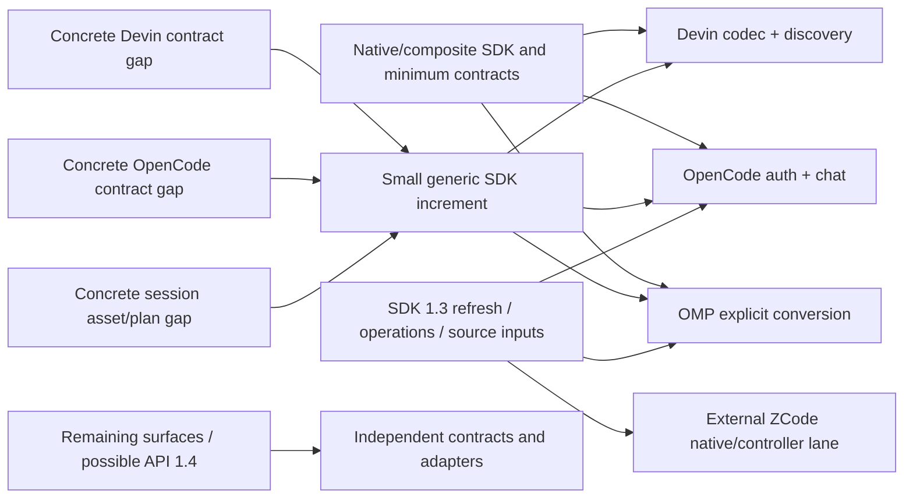

# Deliver Magpie with the SDK before installing our plugins

Date: 2026-11-14

The first rollout is Magpie with our SDK and no external plugins installed.
It must retain ordinary core operation, the fork release workflow/update feed
and local macOS update signing. Module installation, account migration and
vendor acceptance are later steps. Existing module owners continue in
parallel; their unfinished features do not block this first host candidate.
The coverage census remains the SDK backlog, not a sequential prerequisite
for every module.

## Current bases and workspaces

- Host implementations are consolidated on `devzeus`, runtime checkpoint
  `d07078c7926daf6f33af09c40297c941bd39da92`, SDK API 1.6/native ABI 1.
  The [consolidated validation record](../adr/0021-consolidated-sdk16-validation.md)
  separates completed scoped gates from whole-repository acceptance.
  No further host branches or worktrees are needed for module-specific SDK
  variants. New generic fixes belong on this shared base.
- [Native/composite](../adr/0005-native-composite-validation.md),
  [gateway hooks](../adr/0006-gateway-hooks-validation.md),
  [API 1.3](../adr/0009-sdk13-validation.md) and
  [API 1.4](../adr/0014-sdk14-validation.md) records retain their exact
  historical evidence. They do not automatically validate a later tree.
- Active modules have separate adjacent repositories and a development
  replacement for the public SDK:
  `../magpie-sdk-plugin-protocol-devin`,
  `../magpie-sdk-plugin-provider-opencode`,
  `../magpie-sdk-plugin-session-omp`, and
  `../magpie-sdk-plugin-protocol-zcode`, plus
  `../magpie-sdk-plugin-protocol-commandcode`. Each owns its implementation,
  provenance, packaging and acceptance. The former `magpie-extensions`
  workspace is not used by implementation or verification.
- `../magpie-devzeus-archive` is the retained historical donor. The recovered
  uncommitted host work was inventoried and compared with the consolidated
  implementation; backups remain preserved. Devin protocol evidence is under
  `../../Agents/devinapp`.
- SDK source remains in the public fork `TransmuteLabs/magpie`, with canonical
  Go module path `github.com/yetone/magpie`. A separate SDK repository is not
  required. The adjacent module repositories use a development
  replacement `replace github.com/yetone/magpie => ../magpie`; that local
  replacement is not a downloadable release version.

The local replacements do not make unpublished commits downloadable. A
published plugin source later pins an available fork revision, while users
install compiled module distributions separately.

## First host rollout

The SDK is dormant with empty SDK and legacy catalogs. Acceptance exercises
the ordinary built CLI/gateway and the public server front with Bun
unavailable, without installing a fixture module or migrating an account.
The permanent gateway regression also checks ordinary model discovery and a
real request to a synthetic configured provider.

The [update owner](../subsystems/app-updates.md) retains the existing fork
feed and stages a verified download before optional local-key signing and
replacement. Tests of that policy do not establish real Keychain access,
macOS permission continuity or an installed-app transition. Publishing,
installation and restart remain separate from source verification.

## Independent module slices

| Lane | Current slice | Minimum contract | Specific integration gate / remaining work | Independent of |
| --- | --- | --- | --- | --- |
| Devin | Paired native inbound/outbound execution, discovery, auth, agent and bootstrap implementation | Distribution declares its exact minimum; bootstrap uses API 1.6 native account operations, ABI 1 | Synthetic paired inference passes; duplicate assignment and bootstrap-read acceptance remain open. Native startup, signed history and delegation require separate proof | Unrelated media, Memory and other module releases |
| OpenCode | Native Go device auth/refresh, four Go models and an optional agent/window distribution of the same module | Provider minimum API 1.3; agent/window minimum API 1.5; ABI 1 | Installed-host auth/launch/Library/provider slices have scoped evidence. Zen/Console parity and native SQLite history remain separate work | Unrelated SDK owners and other module releases |
| OMP sessions | Lossless interchange, attachment-aware native migration and optional JSONL Source distribution | Default API 1.3; alternative Source distribution API 1.6; ABI 1 | Repaired OMP→Codex export has actual Codex 0.160 continuation evidence. Other routes, source grants and client versions retain their own records | Provider execution, routing and other module releases |
| ZCode | Native provider/controller, auth, SQLite state and optional agent/window in one package | Provider/controller and agent/window distributions declare different minima; ABI 1 | Installed-host synthetic agent/auth/transport proof is separate from actual ZCode startup. Donor billing/claim parity and safe native resume remain active work | Unrelated SDK owners and other module releases |
| CommandCode | Native account/auth/quota and recovered generation transport with checked agent integration | Current package API 1.5/native ABI 1 | Jev is explicitly refused until a generic decision operation/model adapter is implemented. Own-model capability metadata also needs a bounded host addition | First plugin-free host rollout and unrelated module features |

Repository names follow `magpie-sdk-plugin-<type>-<name>`. The type names the
primary purpose, not an exclusive runtime or capability set. Each module
owns its domain code, tests, command entry, package manifest,
optional web assets and README. No module imports host `internal` packages.
There is no shared vendor utility layer until real duplication justifies one.

## Contract freeze and blocker rule

A module declares only the capabilities and minimum version it uses, rather
than copying the host's FullContract superset. The transport/SDK may grow
without adding new requirements to an existing module. API 1.3's new
operation declarations, extended models and rotating-refresh guarantee need
their minimum floor; native ABI remains 1. Future API 1.4 work is not a
dependency for modules that already have their required adapters.

When blocked, the module lane reports:

1. The exact user-visible slice it cannot complete.
2. The required input/result/state semantics and owning host subsystem.
3. The source evidence or sanitized fixture that demonstrates the gap.
4. The smallest generic contract and an acceptance test.
5. Work that remains independent and continues in the meantime.

The SDK lane implements that bounded contract; it does not bring the vendor
implementation into core. Module lanes keep working against their frozen
minimum, fixtures or explicit contract-level doubles until the host adapter
is ready. A double is recorded as such and is not actual-host proof.

Do not respond to an unsupported vendor field by discarding it, approximating
its meaning or widening an HTTP allowlist without a defined operation
contract. The OMP source-input and OpenCode rotating-refresh blockers now
have bounded generic implementations. Native Devin constraints/signed
history, ZCode native lifecycle and provider outside-call policy retain
separate work. An additional gap needs its own evidence; it is not a reason
to stop independent module progress.

## Parallel ownership and verification

- Five module lanes own disjoint repositories: Devin, OpenCode, OMP, ZCode and
  CommandCode.
- The SDK owner works only on agreed generic blockers.
- A verification lane runs the frozen SDK aggregate and module host gates.
- An independent reviewer checks contract boundaries and fixes.
- ZCode implementation is active after the merged upstream checkpoint; vendor
  logic stays in its external repository.

All builds and tests use `usbox`; `usbox-adm` is administration only.
Heavy aggregate verification has at most three jobs, while module lanes use
bounded focused tests and pinned shared caches. Tests use temporary
configuration, synthetic HTTP and reviewed fixtures; no live sign-ins,
accounts, sessions, installed-app replacement or vendor calls.

Report readiness per slice:

- **Domain-tested:** extracted implementation passes relevant fixtures.
- **Installable:** bundle builds and installs under the declared minimum.
- **Host-integrated:** ordinary host discovery/dispatch/off/update behavior
  passes through the actual adapter.
- **Vendor-validated:** separately authorized real-client/vendor evidence
  establishes the stated behavior.

A module can reach its first host-integrated slice while optional features
remain in development. Only that slice is advertised as ready. Local commits
are coherent per module/SDK boundary; publication and deployment are separate
actions.
