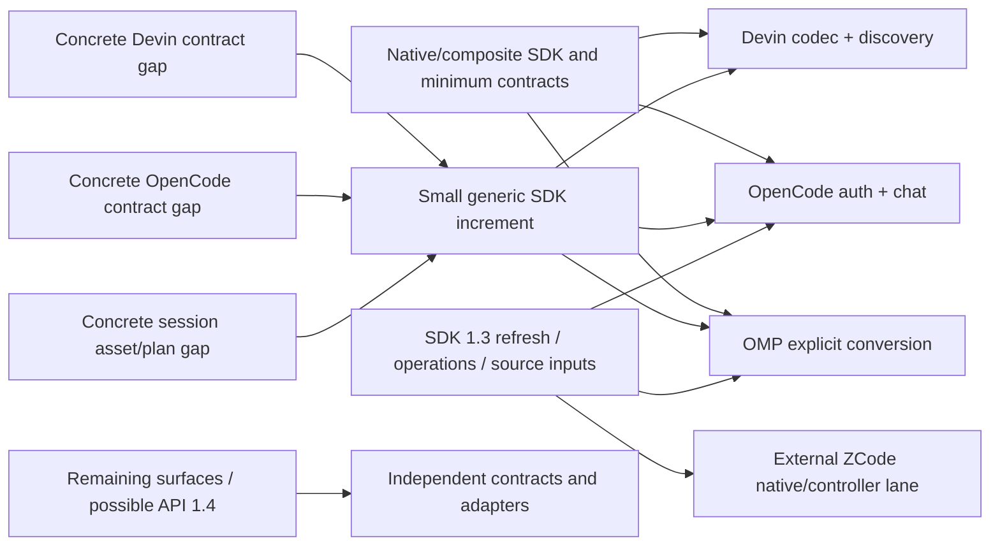

# Deliver our plugins alongside the SDK

Date: 2026-11-13

This plan follows the user's request to begin useful plugin implementation
before completing unrelated SDK surfaces. The coverage census remains the
backlog; it is not a sequential prerequisite for every module.

## Current bases and workspaces

- Upstream was merged at `01bcc7c7d155b029769327f909372b2ff72252e2`.
  The current API 1.3 checkpoint has a
  [combined validation record](../adr/0009-sdk13-validation.md), including
  transactional refresh, finite provider operations, rich models and session
  input planning. It is a scoped SDK checkpoint, not full surface completion
  or a green whole-repository claim.
- SDK API 1.1 is committed locally at `b3055364`, with its
  [scoped validation record](../adr/0005-native-composite-validation.md).
  It has not been published by this work.
- API 1.2 gateway hooks/private tools are committed locally at `e9831f37d`.
  The [validation record](../adr/0006-gateway-hooks-validation.md) distinguishes
  immutable aggregate tree `7e2a72b6178eb2a51c4e6018ee9515fdbb321da7` from the
  reviewed generation-authorization follow-up. These features are not
  prerequisites for the first three module slices below.
- The generic HTTP rejection/cancellation correction at `3f213a6d6`
  unblocks Devin's existing codec status contract without adding vendor code
  or changing the native ABI.
- Active modules have separate repositories in `TransmuteLabs`, with adjacent
  local checkouts and a development replacement for the public SDK:
  `../magpie-sdk-plugin-protocol-devin`,
  `../magpie-sdk-plugin-provider-opencode`,
  `../magpie-sdk-plugin-session-omp`, and
  `../magpie-sdk-plugin-protocol-zcode`.
  The repositories were created private; source publication is separate.
  The earlier `../magpie-extensions` scaffold is a read-only relocation
  backup, not the active implementation workspace.
- `../magpie-devzeus-archive` and `../magpie-protocol-sdk` remain read-only
  donors. Recovered Devin evidence is under `../../Agents/devinapp`.
- SDK source remains in the public fork `TransmuteLabs/magpie`, with canonical
  Go module path `github.com/yetone/magpie`. A separate SDK repository is not
  required. All four adjacent module repositories use the tested development
  replacement `replace github.com/yetone/magpie => ../magpie`; that local
  replacement is not a downloadable release version.

The local replacements do not make unpublished commits downloadable. A
published plugin source later pins an available fork revision, while users
install compiled module distributions separately.

## Independent first slices

| Lane | Current slice | Minimum contract | Specific integration gate / remaining work | Independent of |
| --- | --- | --- | --- | --- |
| Devin | Installable native inbound Connect/protobuf/discovery, with actual ordinary HTTP ingress to a synthetic provider; outbound codecs/client/auth are a separate continuation | Stable manifest: SDK API 1.1/native ABI 1; inbound-codec, model-discovery and the generic HTTP status fix | Inbound guard/catalog/framing/cancel/off-on proof is separate from live Devin compatibility; outbound handler registration, native-only history and owner constraints remain | Agent launch, Library, media, unrelated UI |
| OpenCode | Native Go device auth, transactional refresh, four packaged Go models on chat/Gemini, quota | SDK API 1.3/native ABI 1; account-auth, model-discovery, outbound-executor, usage-reporter | Local `031d093` has actual native ordinary expiry renewal, four model tests and isolated account rotation; Zen/free behavior, agent integration and live-vendor proof remain outside this slice | Standalone media operations, Library target, agent launch, optional TS UI |
| OMP sessions | Lossless explicit interchange plus attachment-aware native routes declared for OMP↔Claude and OMP↔Codex | SDK API 1.3/native ABI 1; session-migration, module-rpc, read-only session.inputs.v1 | Actual OMP→Claude ordinary native carry/read/resume proof; reverse, Codex and large-document acceptance retain their own owner records | Generic SDK discovery/reader/resume registration, router, provider extras, Library |
| ZCode | Active external native Messages/PAT-refresh slice and vendor execution/billing/reset controller work | SDK API 1.3/native ABI 1; selected auth/executor/model/usage/operation and declared module actions | The earlier migration hold ended after the upstream merge; family/session/claim/reset semantics and vendor parity require the module's explicit owner contracts and evidence | Unrelated SDK surface completion |

Repository names follow `magpie-sdk-plugin-<type>-<name>`. The type names the
primary purpose, not an exclusive runtime or capability set. Each module
owns its domain code, tests, command entry, package manifest,
optional web assets and README. No module imports host `internal` packages.
There is no shared vendor utility layer until real duplication justifies one.

## Contract freeze and blocker rule

A module declares only the capabilities and minimum version it uses, rather
than copying the host's FullContract superset. The transport/SDK may grow
without adding new requirements to an existing module. API 1.3's new
operation declarations, extended models and rotating-refresh guarantee need
their minimum floor; native ABI remains 1. Future API 1.4 work is not a
dependency for modules that already have their required adapters.

When blocked, the module lane reports:

1. The exact user-visible slice it cannot complete.
2. The required input/result/state semantics and owning host subsystem.
3. The source evidence or sanitized fixture that demonstrates the gap.
4. The smallest generic contract and an acceptance test.
5. Work that remains independent and continues in the meantime.

The SDK lane implements that bounded contract; it does not bring the vendor
implementation into core. Module lanes keep working against their frozen
minimum, fixtures or explicit contract-level doubles until the host adapter
is ready. A double is recorded as such and is not actual-host proof.

Do not respond to an unsupported vendor field by discarding it, approximating
its meaning or widening an HTTP allowlist without a defined operation
contract. The OMP source-input and OpenCode rotating-refresh blockers now
have bounded generic implementations. Native Devin constraints/signed
history, ZCode native lifecycle and provider outside-call policy retain
separate work. An additional gap needs its own evidence; it is not a reason
to stop independent module progress.

## Parallel ownership and verification

- Four module lanes own disjoint repositories: Devin, OpenCode, OMP and ZCode.
- The SDK owner works only on agreed generic blockers.
- A verification lane runs the frozen SDK aggregate and module host gates.
- An independent reviewer checks contract boundaries and fixes.
- ZCode implementation is active after the merged upstream checkpoint; vendor
  logic stays in its external repository.

All builds and tests use `usbox`; `usbox-adm` is administration only.
Heavy aggregate verification has at most three jobs, while module lanes use
bounded focused tests and pinned shared caches. Tests use temporary
configuration, synthetic HTTP and reviewed fixtures; no live sign-ins,
accounts, sessions, installed-app replacement or vendor calls.

Report readiness per slice:

- **Domain-tested:** extracted implementation passes relevant fixtures.
- **Installable:** bundle builds and installs under the declared minimum.
- **Host-integrated:** ordinary host discovery/dispatch/off/update behavior
  passes through the actual adapter.
- **Vendor-validated:** separately authorized real-client/vendor evidence
  establishes the stated behavior.

A module can reach its first host-integrated slice while optional features
remain in development. Only that slice is advertised as ready. Local commits
are coherent per module/SDK boundary; publication and deployment are separate
actions.
