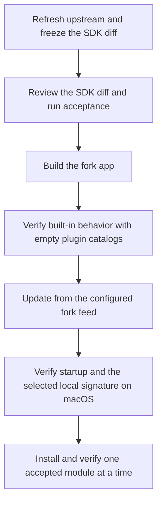

# First rollout of Magpie with the SDK

The first installation is Magpie with empty SDK and legacy plugin catalogs.
Built-in features are available immediately. Install individual modules after
their own acceptance, then verify their ordinary entry points with the real
clients and accounts they serve.

## Host and modules

The SDK source ships in the Magpie repository and its distribution follows
the application release version. Modules declare a minimum wire API and, for
native Go, a native ABI version. A declaration determines what the host may
load. Verification records identify the host source that was actually tested.

The seven modules share the `magpie-sdk-community-plugins` repository. Each
package includes its runtime components, fixtures and source lock, and has an
independent release version. Use the companion repository's package status
and source locks for donor versions, supported platforms and module-specific
acceptance.

| Concern | Reference |
| --- | --- |
| Runtime, compatibility and installation | [Installable extension modules](../subsystems/executable-extensions.md) |
| Owners and ordinary host entry points | [Extension surface coverage](../subsystems/extension-surface-coverage.md) |
| Cross-account retry and vendor error facts | [Shared request policy](../subsystems/request-policy.md) |
| Release feed, update controls and local signing | [App updates](../subsystems/app-updates.md) |
| Decisions and historical verification | [SDK evidence index](../adr/README.md) |

## Release sequence

1. Review the common SDK diff against its upstream base. Run host tests and
   platform builds on the identified tree. Exercise the rendered GUI on
   Chromium and WebKit for GUI changes. Record the exact tested tree, failures,
   explicit skips and the results of behavioral regression controls.
2. Accept the fork build through its ordinary CLI and gateway with empty
   catalogs and Bun unavailable. Check discovery and inference against a
   local fixture, plus normal shutdown. Exercise the fork's feed and the
   local-signing setting in the application and CLI.
3. Confirm publication prerequisites on the release commit. Use the existing
   configured GitHub feed when updating the installed app. Confirm download
   integrity, signing with the selected Keychain identity and restart on the
   actual Mac. Retain the fixture and real-update results separately.
4. Build and install each ready module independently. Check the packaged
   provenance and ordinary entry points. Validate any account adoption or
   session migration with the real client before moving existing state.

## Review and verification boundaries

The SDK change for upstream contains the public contracts and their generic
host adapters. The fork's workflow, existing update source and local
signing policy belong to the fork. Domain modules stay in the companion
repository. An SDK version, donor tag or green package build establishes
only the scope recorded by its corresponding check.
