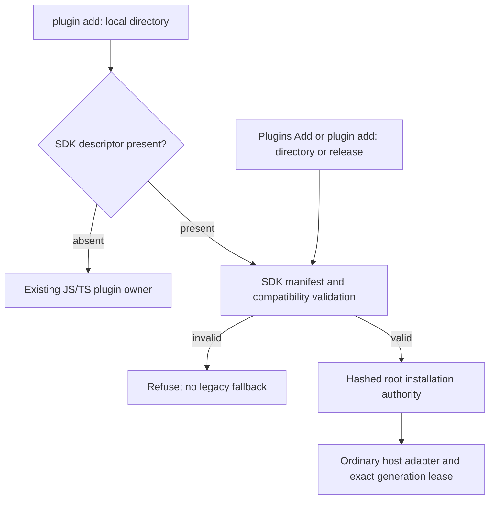
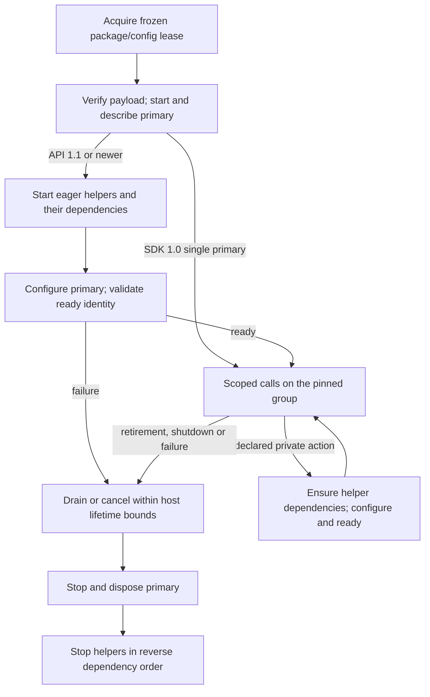

# Installable extension modules

Magpie installs modules without rebuilding the application. A module has one
native Go, executable or Bun primary and may include private services and
prebuilt window assets. Modules own their domain behavior; the host owns
installation authority, selected scope, permission checks and lifecycle.
Magpie also runs with no external modules: with an empty SDK catalog, these
adapters start no module library, worker or Bun process. Built-in features keep
their ordinary owners. Legacy installation and retired-account migration have
their own [provider/plugin policy](provider-plugins.md); they are not an SDK
startup grant or an automatic-install promise.

The available SDK contract is API 1.18. Authors declare the minimum contract
and capabilities their module uses; a newer SDK does not enable every adapter
or raise an existing module's contract. Explicit SDK 1.0 single-primary modules
remain supported. Capability-specific floors and failure rules belong to the
details linked below.

SDK distribution is alpha and follows the application release, tag and source
checkout. The Go SDK belongs to the application Go module. The JS package uses
the same build `VERSION` via `make sdk-js-pack`, with a checked-in development
placeholder of `0.0.0-alpha.0`; the release owner must pair both outputs from
the same checkout. This packaging target does not publish or alter ordinary
application build dependencies. Release versions are distinct from wire API
1.15 and native ABI 1. Manifest minima, negotiation and capability gates retain
their protocol numbering. See the [JS packaging instructions](../../sdk/js/README.md).

| Task or reader | Owning reference |
| --- | --- |
| Install, update, select a runtime or configure a component group | This page: [installation](#installation), [components](#module-components-and-configuration) and [lifetime](#transport-lifetime-and-replacement) |
| Write a Go or Bun module and its handlers | [Go author guide](../../pkg/extension/README.md) and [JS/TS author guide](../../sdk/js/README.md) |
| Expose a protocol or constrain native execution | [Codec embedding](protocol-extensions.md) and the [native gateway path](#native-gateway-path) |
| Authenticate accounts, execute operations, report quota or run declared account work | [Providers and accounts](extension-providers.md) |
| Order routing candidates or classify a refusal | [Routing strategies](#routing-strategies-api-14) and [shared request policy](request-policy.md) |
| Add window actions, account selection or a polling sign-in flow | [Window integration](#window-integration) |
| Wire an agent, select a profile, read or migrate sessions | [Agents and sessions](extension-agents-sessions.md) |
| Run declared agent processes and finite duplex calls | [Owned process transport](extension-processes.md) |
| Register search, tools or gateway callbacks | [Search sources](extension-search.md), [plugin tools](plugin-tools.md), [request hooks](gateway-request-hooks.md) and [gateway middleware](gateway-middleware.md) |
| Read scoped catalog/storage data or observe accounting | [Public host-service contracts](../../pkg/extension/README.md#shared-contract-and-transport), [usage ownership](extension-providers.md) and the [adapter census](extension-surface-coverage.md) |

Account-only services, inference providers and private components retain
distinct grants. A component handshake describes that component; the installed
root manifest remains the permission source. Request-policy recovery supplies
bounded response facts to the host's existing budget and disposition owners;
it grants no account selector or reactive credential refresh.

The [decision and evidence index](../adr/README.md) preserves architectural
rationale and historical validation snapshots, including original failures.
Those records do not establish acceptance of another source tree, live vendor
compatibility or an untested platform.

## Sources of truth

| Owner | Responsibility |
| --- | --- |
| [`pkg/extension`](../../pkg/extension/README.md) | Public Go contracts, server, actions, lifecycle and codec adapter |
| [`pkg/extension/native`](../../pkg/extension/native/native.go) | Author registration and SDK-owned C exports |
| [`sdk/js`](../../sdk/js/README.md) | Corresponding Bun/JS worker and declarations |
| [`catalog.go`](../../internal/extension/catalog.go) | Package copies, generations, hashes, release provenance and atomic catalog |
| [`release.go`](../../internal/extension/release.go) | GitHub release selection, SHA-256 and bounded ZIP staging |
| [`manager.go`](../../internal/extension/manager.go), [`client.go`](../../internal/extension/client.go) | Leases, bounded RPC, cancellation and replacement |
| [`module_transport.go`](../../internal/extension/module_transport.go), [`native_cgo.go`](../../internal/extension/native_cgo.go) | Process/native transports and platform loader |
| [`components.go`](../../internal/extension/components.go), [`module_config.go`](../../internal/extension/module_config.go) | One generation's component group, readiness and root configuration CAS |
| [`module_window.go`](../../internal/extension/module_window.go), [`extension_window.go`](../../internal/gui/extension_window.go) | Revision/config-bound window parts and bindings |
| [`store.go`](../../internal/extension/store.go) | Scoped state, account CAS and durable operation journal |
| [`refresh.go`](../../internal/extension/refresh.go), [`refresh_store.go`](../../internal/extension/refresh_store.go) | Cross-process refresh ownership, bounded lifetime, atomic credential/expiry publication and replay fences |
| [`extension_operations.go`](../../internal/provider/extension_operations.go), [`provider_operations.go`](../../pkg/extension/provider_operations.go) | Exact operation admission, extended model validation and author/host enforcement |
| [`inbound.go`](../../internal/extension/inbound.go) | Native codec calls and response encoding |
| [`executor.go`](../../internal/extension/executor.go), [`protocol_executor.go`](../../internal/gateway/protocol_executor.go) | Same-module native executor policy and exact inbound lease checks |
| [`usage_runtime.go`](../../internal/extension/usage_runtime.go), [`usage_store.go`](../../internal/extension/usage_store.go) | Accepted-write invalidation, durable usage revisions and inference admission |
| [`protocol_extensions.go`](../../internal/gateway/protocol_extensions.go) | Gateway guards and canonical dispatch |
| [`sdk_cli.go`](../../internal/cli/sdk_cli.go) | Installation, inspection, auth and explicit file-plan application |

The public SDK imports no private Magpie package. `FullContract()` advertises
SDK API `{major: 1, minor: 15}`. The finite operation
registry adds no capability name. Explicit SDK 1.0 manifests
without composite fields retain their original single-primary behavior and
need no component configuration. The legacy Go codec interface has an
independent version.

The session-source decision is [ADR 0019](../adr/0019-jsonl-session-sources.md).
[Native account operations](../adr/native-account-operations.md) negotiate
codec 0.5 separately from SDK 1.6. Both declarations survive the primary
handshake and cloning; private services inherit neither authority.
No modules are required to run Magpie. With empty SDK and legacy catalogs,
these adapters preserve built-in agent/provider owners and do not start
native libraries, executable workers or Bun.

## Selection and authoring

A local directory with `magpie-plugin.json` selects the SDK installer. An
absent descriptor leaves existing JS/TS loading in charge; file extensions
do not guess an SDK runtime. An explicitly present malformed or incompatible
SDK descriptor is an error, never a fallback to legacy TS. Existing
OpenCode/Pi plugins keep their owners.



The selection edge is implemented by
[`pluginCmd`](../../internal/cli/plugins_cli.go); explicit SDK installation uses
[`Manager.Install`](../../internal/extension/manager.go) and
[`Catalog`](../../internal/extension/catalog.go). Runtime start verifies the
public handshake in [`startWorker`](../../internal/extension/client.go).
Neither a filename extension nor a component's public projection replaces the
installed root authority.

| Primary runtime | Author entry | Runtime boundary |
| --- | --- | --- |
| `native` | `native.Register(extension.Module)` in `init`; empty `main`; build with `-buildmode=c-shared` | Shared library in Magpie's PID; no author C or RPC glue |
| `exec` | `extension.Serve` over stdin/stdout | Supervised executable with its own Go runtime |
| `bun` | JS SDK `serve(module)` | Supervised Bun process |

The [native example](../../examples/extensions/echo-native/README.md) and
[hybrid example](../../examples/extensions/hybrid-go/README.md) contain the
actual build scripts and author source. Native authoring and loading require
cgo and an appropriate C toolchain. Platform loader branches and cross-builds
are distinct from native execution. The
[historical evidence index](../adr/README.md#historical-validation-records)
retains the exact platform/snapshot qualifications; this reference establishes
no new platform execution result.
No-cgo or unsupported hosts refuse native loading clearly and retain exec/Bun.

## Installation

A distribution contains `magpie-plugin.json` and its runtime files. It declares
`schema`, `id`, semantic `version`, `runtime` (`native`, `exec` or `bun`), relative
`entry`, optional `args`, `contract` and capability-specific descriptors.
Native libraries have no process arguments. A hybrid distribution includes
every component and its window assets in the same hashed package.

```sh
magpie plugin add 'github:owner/repository#minimax'
magpie plugin update minimax
magpie plugin sdk add ./distribution
magpie plugin sdk add github:owner/repository
magpie plugin sdk add github:owner/repository@v1.2.3
magpie plugin sdk add 'github:owner/repository#minimax'
magpie plugin sdk add 'github:owner/repository#devin-inbound@devin-inbound-v0.8.0'
magpie plugin sdk update
magpie plugin sdk update my-module
magpie plugin sdk list --json
magpie plugin sdk inspect my-module
magpie plugin sdk config my-module
magpie plugin sdk config my-module '{"value":"example"}' --expected 0
magpie plugin sdk off my-module
magpie plugin sdk on my-module
magpie plugin sdk reload my-module
magpie plugin sdk rm my-module
```

Use a Magpie build containing this SDK; an older installed application does
not acquire these commands from a module. The config write above assumes
the preceding read returned version `"0"`; always use the version actually
read. It replaces the complete JSON object rather than merging keys and
does not start a worker just to read configuration.

The ordinary Plugins page and `magpie plugin add` accept a directory with
`magpie-plugin.json` or a scoped GitHub release source. An unpinned `#module`
is recognized when its release exposes a matching SDK ZIP name. A Git reference
without matching release evidence still goes to the JavaScript package
installer. Prefix the source with `sdk:` or use `plugin sdk add` to require
SDK installation and get SDK-specific errors. Unscoped `github:owner/repo`
keeps its original Git-package meaning in the ordinary installer.

Installed SDK modules appear alongside legacy packages. Their capabilities,
agents, providers, protocols, session formats and compatibility come from the
installed manifest. An optional `description` in the archive's root
`package.json` supplies the display description. Reading Installed requires
neither a module worker nor a GitHub request. Check for updates reads release
metadata. Installing an update verifies the archive before switching generations.
Use `sdk:<id>` to select an installed module explicitly if a legacy package
uses the same name.

Explicit SDK GitHub sources install prebuilt packages from public or private
releases. The unscoped, unpinned form follows GitHub's latest published release.
`@tag` selects and pins an exact semantic version tag, with or without a
leading `v`.

Repositories publishing independently versioned SDK modules can opt in to
`github:owner/repository#manifest-id[@manifest-id-vSEMVER]`. The selector is the
exact manifest ID, not a directory or provider name. It appears before the
optional full module tag pin; `github:owner/repository@tag#module` is not
reinterpreted. An omitted selector keeps the legacy source, tag grammar,
repository-latest lookup and asset behavior.

[`release_auth.go`](../../internal/extension/release_auth.go) resolves
credentials lazily after a direct repository release API 401/403/404:
`GH_TOKEN` / `GITHUB_TOKEN`, then `gh auth token --hostname github.com`,
then noninteractive HTTPS Git credential lookup for that repository.
The desktop uses the same tool discovery as the rest of Magpie, including
common developer bin directories when GitHub CLI is outside the app's PATH.
SSH-only Git access cannot authenticate the Releases API. Credentials are
attached to the selected repository's API metadata/asset requests and are
not persisted in the catalog or module/provider
configuration. Offline tests exercise this flow; no live private-repository
login is implied.

A release publishes `magpie-plugin_<os>_<arch>.zip` and `checksums.txt`.
For example, macOS Apple Silicon uses `magpie-plugin_darwin_arm64.zip`.
A Bun package may instead publish `magpie-plugin_any.zip`, selected only when
the platform asset is absent. The ZIP contains the distribution directly,
with `magpie-plugin.json` at its root and executable permissions preserved.
Its manifest version must match the release tag. `checksums.txt` contains
GNU SHA-256 entries for the exact archive names:

```text
<64 hexadecimal characters>  magpie-plugin_darwin_arm64.zip
```

With a module selector, the asset names are instead
`magpie-plugin_<manifest-id>__<os>_<arch>.zip` and the Bun-only fallback
`magpie-plugin_<manifest-id>__any.zip`. The complete selected ID determines the
prefix, including any `_` or `__` inside it. A scoped request never falls back
to another module or a legacy asset. Each release contains only that module's
platform assets and `checksums.txt`; entries name each exact archive. The staged
manifest ID and version must match the selector and full module tag before
handshake or catalog publication. Persisted provenance is checked against both
on catalog reads.

For scoped sources, each module has independent `<manifest-id>-v<semver>` release
tags. IDs may contain `-v`: the resolver first validates the entire version
after the selected ID's prefix. If that is invalid, a complete longer valid
SDK ID plus valid semantic version identifies a sibling tag to ignore.
Otherwise a malformed selected-prefix tag, such as `foo-vbroken`, still fails
closed. A valid selected version retains its complete prerelease/build suffix;
overlapping tag spellings never relax scoped asset or manifest ID/version
checks, including for exact pins.

An unpinned lookup scans GitHub's release list in pages of100, up to10 pages
and the existing1MiB metadata limit per page. It chooses the highest stable
semantic version of the selected module after the complete listing, rather
than repository latest or the first matching release. A later-published backport
does not displace a higher version. Drafts, prerelease flags and semantic
prereleases are excluded from unpinned updates. A full explicit pin can select a
published prerelease, but never a draft.
GitHub's numeric repository URLs in pagination links can indicate another
page. Every request still uses the original named repository and the next
bounded page number.

Every decoded release record must identify a nonblank tag, including unrelated
or draft rows; null or empty objects fail before archive download/publication.
Unused optional GitHub fields remain optional. An explicit `Link rel=next`
prevents a short page from terminating the scan. Only the independently
constructed next canonical repository page is requested, within the same
ten-page bound and credential scope. Malformed, duplicate, foreign, skipped or
out-of-bound next links fail closed; Link targets are never followed directly.
Previous/first/last links do not themselves authorize additional requests.

A failed, malformed, duplicate/ambiguous or truncated listing stops resolution;
the page bound requires an explicit module tag pin. The resolver does not return
a partial maximum. A newest module release lacking an asset for this platform
also fails, without falling back to an older module version. Existing catalog
comparisons prevent module-version downgrade and changed bytes at the same
semantic version; an unchanged module retains its generation. A pin stays local
on ordinary update. Explicit reinstall retains its existing replacement path.
Legacy unscoped manifests still match their ordinary semantic release tag.

The downloader uses Magpie's proxy policy, HTTPS and bounded responses. It
verifies the archive digest before extraction, rejects ambiguous asset names,
links, special files and duplicate/case-colliding paths, and bounds both
declared and actual decompressed bytes. Temporary staging feeds the same
catalog installer as a local directory. A checksum from the publisher's own
release detects corruption; it is not an independent publisher signature.

The installer rejects traversal, symlinks, non-regular payloads, oversized
packages and conflicting ownership. It copies a unique generation, hashes
every file, verifies the worker's public handshake and rechecks the payload
before publishing. A failed check keeps the old catalog. Concurrent writes
use compare-and-swap under a lock. Upgrade preserves a user's disabled setting.

Data lives under `appdir.Config()/extensions`. Removal revokes new work but
retains private state and payload generations for recovery and workers still
draining in another gateway process.

GitHub installations record the requested source, resolved tag, asset name
and verified digest in the hashed catalog entry. Old local entries without
that optional field keep their revision format. `sdk inspect` exposes the
saved provenance. `sdk update` updates tracked unpinned packages; pins and
local directories remain unchanged. Ordinary `magpie plugin update` runs both
legacy and SDK updates; an SDK-only installation does not need Bun for this.
Scoped references retain their exact selector and optional pin in that same
provenance field and use the same private-repository credential/redirect owner.
No periodic background updater or
registry is implied.

An update keeps module identity, disabled state and private state. It cannot
overwrite a module removed or replaced while the download was running.
An unchanged release retains its generation, and an older latest alias
cannot downgrade an installed version. Changed bytes at the same semantic
version require an explicit reinstall. Download, validation and handshake
failures leave the previous published generation active. Once published,
old workers drain under the ordinary lifecycle; vendor state is not rolled
back automatically. To select another version, explicitly add its tagged
source again. A local reinstall clears the remote source.

## Gateway activation (API 1.8)

A root `activation: ["gateway"]` explicitly requests a component lease while
the ordinary gateway listens. Unknown or duplicate activation points and
pre-1.8 declarations fail admission. `Server.New`, `Server.Front`, metadata
discovery and a failed listener bind acquire no activation. Empty catalogs
continue to need no module, native library, executable worker or Bun.

After successful bind, [`extension_activation.go`](../../internal/gateway/extension_activation.go)
attaches [`Manager.BeginGatewayActivation`](../../internal/extension/gateway_activation.go).
Its handle resolves active root modules under the gateway lifetime, pins
package, enablement and configuration identity, reconciles local and external
catalog changes, and joins its removable change subscription.
Disable, removal, configuration replacement and shutdown release the lease
and retire the cached generation through the existing bounded drain and
disposer before replacement. Startup failure is logged and the ordinary
listener continues serving.

Private service manifests inherit no activation. Public component
handshakes also omit a provider's check-in declaration when its referenced
action belongs to a different component, just as they omit that action;
the installed root retains the complete registration authority.

## Module components and configuration

Capability handlers stay on the primary; private services receive only their
declared actions. Composite declarations and `module-rpc` require API 1.1.
Only `module.call {action,input}` routes by action owner; codec/provider/response
calls retain the primary lease. Hooks, private tools, provider operations and
credential refresh keep the grants in their owning references.

The complete root manifest declares `actions`, `services`, `compatibility`,
`window` and `bindings`. Actions name an owner and `read`/`write` effect.
Private services use `exec` or `bun`, an exact contract ID/version, their
owned action IDs in `methods`, `eager`/`lazy` start, an acyclic `dependsOn`
graph, and named readiness endpoints. At most 16 services may be declared,
even when several use one binary; the aggregate descriptor budget is 1024.
Primary and service entry paths are relative to the distribution, not the
process working directory. The [hybrid layout](../../examples/extensions/hybrid-go)
keeps the primary in `lib/`, the helper in `bin/` and static assets in `ui/`.

`Manifest.Public()` is only the component handshake: it removes packaging,
compatibility, services, window, bindings, owner registrations, settings
declarations and actions owned elsewhere.
`ServiceManifest(root,id)` derives the helper's root identity/version,
component contract and owned actions without delegating the nine primary
capabilities. Host authorization retains the complete root descriptor.

SDK-owned `component.configure`, `component.ready` and `component.stop`
manage API 1.1 instances. Go `Module.Start` returns `ModuleReady` and a
disposer; JS `module.start` returns endpoints/state/dispose. Dependencies
start before dependents; eager services start before the primary is
configured. Startup defaults to ten seconds, or a declared service timeout
up to five minutes. Readiness must match component, contract, opaque
instance, config version and exactly the declared loopback endpoints.
The Go SDK and host share `extension.ValidReadyURL`; JS validates the same
HTTP(S) policy: a numeric loopback IP and explicit nonzero port, at most 4096
UTF-8 bytes, no credentials, query or fragment (even empty), and no DNS names.
HTTPS keeps ordinary trusted TLS verification; this check does not dial URLs.
The hook creates its own servers; the SDK provides no HTTP framework.

Configuration lives at the fixed `Scope{Plugin: rootID}` / `module.config`
key. Its canonical decimal uint64 CAS version and bounded JSON object form
one immutable snapshot for the group. Updating configuration creates a new
root runtime generation. An old lease keeps its old code/configuration,
including a lazy helper first started after the update. Account generation
is a separate counter and is inherited unchanged by a nested helper call.

Root packages using API 1.16 can declare `settings`, an ordered array of up to
32 `FeatureSetting` fields. Each declares a `name`, `kind`, `title` and `default`.
Types are `boolean`, `string`, `integer` and `number`. Fields may have a
`description`, up to 32 distinct `enum` choices, and `minimum` and `maximum`
for numbers. Integers must be within JavaScript's exact integer range. A
setting key must be unique and cannot also name a provider switch.

**Plugins → Installed → Options** uses the same schema renderer as linked
features. It shows only declared fields and saves only edited keys. The
package revision, enablement generation and config version must still
match when the save takes the catalog lock. Sibling keys survive the patch.
Raw configuration writes from the CLI, window and provider owners share
validation with the form. Module startup and handler snapshots get missing
defaults in memory. Defaults alone create no saved keys, and an update whose
settings reject saved values fails validation without changing them.

`ModuleReady.State` / `ModuleContext.State` is opaque instance-local state
for clients or pools; it stays in the runtime, outside JSON and the C ABI.
Config/dependency maps are copied; State retains its original reference.
Authors synchronize it and release its resources in their disposer.

## Transport, lifetime and replacement



[`Manager.acquireSelected`](../../internal/extension/manager.go) and
[`componentGroup`](../../internal/extension/components.go) own these edges.
Install-time validation also starts and checks every declared service before
publication. At runtime, lazy services start for a declared action or as a
dependency, including a dependency of an eager service. Replacement sends
new acquisitions to the current package/config;
existing leases retain their old group, including a later lazy start on that
same old snapshot. Native ABI logical close and process termination have the
different failure boundaries described below.

Runtime admission and retained refresh use the same manager-before-worker
lock order. Startup is registered while the manager lock is held, so shutdown
joins it; neither startup I/O nor waiting for another start holds those locks.
Restarting a failed transport cannot deadlock a refresh retaining its old lease.
At CLI exit, including signal exit, Magpie gives the existing default SDK
manager up to ten seconds to stop and join its components. Exit closes
admission for the process, including calls arriving after the last manager
has closed or before a manager has been used.
The `serve` and `web` restart paths apply the same process-wide fence before
replacing the executable, including when another process serves the gateway.

A Go-only package needs no Bun process, including a native primary with an
exec Go service and prebuilt TS UI. Bun components use the app's existing
managed Bun owner. The child gets its own HOME and a small process environment;
unrelated provider credentials are not copied into environment variables.

`sdk.describe` must match the installed identity, version, capabilities and
descriptors. Paths/arguments are packaging details. File hashes are checked
before a component starts. A failed runtime is restarted only for a later,
independent call.

Exec/Bun stdin/stdout carry bounded newline-delimited JSON; stdout is exclusively RPC.
Stderr is drained without retaining request data or blocking on long lines.
An envelope is at most 24 MiB, a native request body 16 MiB and a streamed
binary chunk 64 KiB. Host services separately accommodate a 1 MiB state value.
Binary JSON fields use base64.

Native libraries use the same SDK frames through the versioned
[`C ABI`](../../pkg/extension/native/abi.h), synchronous callbacks and
borrowed byte spans. JSON does not imply an external process. Retained spans
are copied, and JSON/base64 processing remains; this is not zero-copy.
No Go pointers or interfaces cross the ABI.

One stream event is outstanding per call; the consumer acknowledges it after
finishing. Ordinary execution, native response encoding and operation control
have separate admission credits. A provider stream cannot consume the credits
needed to encode its own output.

Cancellation reaches component contexts. While a canceled call drains, the
host discards an in-flight callback with its matching authority. Invalid
callback frames still stop the worker. Exec/Bun processes can be retired
after the cancellation grace period; native code must cooperate. Replacement
starts new work in the new root generation while old leases drain for up to
30 seconds. Stop cancels business calls, ACK/host waits and startup, and joins
the returned disposer once. Failed startup also runs its returned disposer.
The primary disposer runs while its helper dependencies are still available;
private services then stop in reverse dependency order with bounded control waits.
Unix process groups and the Windows child-tree owner stop module children.

Native logical close revokes handles and unblocks transport without waiting
for arbitrary module code. Libraries remain mapped until host exit; session
close is not `dlclose`. Native code shares Magpie's environment, filesystem
permissions and failure domain. It must avoid process-global cwd/env changes
for account state; a stuck native call cannot be forcibly killed in isolation.

## Native gateway path

Ordinary `gateway.New()` discovers installed endpoints. Explicit
`NewWithProtocols(registry)` retains deliberately linked Go construction and
does not load installed codecs. Core, page, callback, agent-wrapper and WSL
namespaces cannot be claimed by a module.

1. LAN, Host, proxy, caller, Origin, browser-key and read-only guards precede
   decoding. Gateway-key aliases apply only after canonical normalization.
2. The request binds a verified codec generation. Native bytes/headers are
   bounded and cloned; gateway authorization, cookies and transport headers
   are removed. `X-Magpie-Caller-ID` is an opaque host-generated identity for
   namespacing native caches, not additional authority.
3. The codec returns canonical Chat, Responses, Messages or Gemini JSON,
   authorized Models discovery, or a declared tool call. It cannot select an
   arbitrary administrative route or caller.
4. The normalized request retains peer, caller, session, cancellation and
   decoded deadline, then enters existing routing, account, budget,
   concurrency and accounting owners.
5. Same-module execution and response encoding retain the acquired primary
   generation. `Finish` releases codec state after success, refusal or cancel.

Optional opaque metadata goes only to the same module's provider. A stable
native request ID identifies one logical request in its caller/session;
reusing a completed ID is refused rather than executing it again.

Models discovery projects the authorized catalog without an inference
reservation. Native controls resolve only to the same module's declared
tools and use the existing MCP permission/budget path. They respect the
Plugin tools toggle and cannot select another module's tool.

GUI one-port forwarding recognizes installed routes from the serving instance
or the local installed catalog when proxying to another process. Page-port
marking remains intact; a loopback proxy does not acquire local authority.

## Host services and effects

The host fixes plugin/provider/account/generation/session/operation scope.
A callback cannot substitute another scope.

| Service | Meaning |
| --- | --- |
| `state.get`, `state.cas` | Bounded JSON in the parent plugin/account-generation namespace |
| `network.proxy` | Effective proxy for an HTTP(S)/WS(S) target under the parent's transport policy, without dialing |
| `account.replace` | Replace the selected account after an accepted tool operation and advance its generation |
| `component.call` | Resolve a primary binding against its frozen root group and call the declared action owner |

Proxy choice and its login remain per-call, not shared process environment.
Modules own vendor networking and must honor the resolution. Executables are
trusted local programs, not an OS sandbox.

Account replacement requires account-auth authority and an accepted receipt
for the exact selected account. It returns only ID/generation; the handler
then returns its terminal result, since the old generation is revoked.

Callbacks use their request deadline when reading an operation receipt.
Final receipt collection and journal writes remain with the operation owner.
The host persists acceptance before acknowledging it. Unexplained dispatched
worker death is uncertain. Accepted, uncertain and completed operations are
not automatically replayed or sent to a fallback. A known unsent call may be
reported as not started. Module-specific status/cancel can reconcile an
operation; the journal does not claim a vendor transaction was undone.

### Account refresh and ordinary expiry preflight

A module depending on rotating refresh requires API 1.3 and
`compatibility.hostAPI: "^1.3"`. `Manager.RefreshAccount` and raw
`auth.refresh` through Manager/Lease share one owner: reread the selected
generation under a strict account OS lock, persist dispatch before one unary
RPC, then atomically publish credentials, expiry, generation and a sanitized
receipt. The caller receives no replacement credentials. Same-generation
completed retries reuse the receipt; an ambiguous exchange leaves a durable
uncertain fence. Module mutexes, private state CAS and a post-RPC SaveAccount
alone are not equivalent.

`Account.ExpiresAt` and `AuthResult.ExpiresAt` are Unix milliseconds; zero
means unknown. Ordinary provider execute/model-fetch/usage preflight renews
known expiry within one minute, checks the published successor and refuses
credentials still within 30 seconds of expiry. Cached bindings follow only a
durably proven refresh successor; manual replacement/deletion still revokes
the old selection. Network policy, caller guards and account choice stay with
the host.

After dispatch, caller cancellation stops its wait while the bounded owner
publishes or fences the result. Manager shutdown joins refresh ownership
before closing its clients; it does not wait indefinitely for ordinary
leases to become idle. The transaction cannot recover an unseen token lost
between remote rotation and local publication. See
[ADR 0007](../adr/0007-transactional-account-refresh.md) for exact limits and
upgrade requirements.

### Provider operations and model metadata

API 1.3 `ProviderDescriptor.operations` lists the finite embedding/rerank,
image, audio and video operations in
[`provider_operations.go`](../../pkg/extension/provider_operations.go).
They use the OpenAI-compatible `chat` wire family plus
`ExecuteRequest.operation`; ordinary conversation calls keep an empty
operation. Existing Anthropic/Gemini counting paths remain native protocol
requests. There is no arbitrary upstream URL registration.

`ExecuteOptions` names method, decoded path, query, parent proxy choice and
optional caller/request/native metadata. Only API 1.3 modules receive
`escapedPath`, preserving the earlier option shape for API 1.1/1.2.
`network.proxy` remains the effective transport-policy resolver. Both the
actual leased descriptor and author SDK validate an operation before
authorization/effect dispatch; catalog modalities alone grant no operation.
Ordinary retrieval/media owners preserve accepted-operation fallback fences
and video module/provider/account affinity across credential renewal.

API 1.3 models describe kind, input/output modalities, default/maximum context,
release, temperature, service tiers, subscription rates and reasoning
defaults. Nil/unknown modality declarations differ from explicit empty lists;
user overrides stay authoritative. Dedicated decisions, provider options,
check-in and background keepalive remain separate contracts.

ModuleRPC is unary: one terminal JSON value, with only an acknowledged
`accepted` receipt permitted for a write. Read actions cannot emit; data and
progress events fail the call even when a handler catches the Emit error.
For a write delegation, the primary must already have durable acceptance
for the same root operation. The helper inherits its lease, selected account,
auth generation, cancellation and operation; it creates no second dispatched
journal entry. A read parent cannot delegate a write. These action semantics
do not add inference retry or MCP permission behavior.
Root ModuleRPC parameters have the bounded frame budget
`MaxFrameBytes - 4096`; scoped callbacks retain their independent
`MaxHostBytes` budget. Large session input is not permission to enlarge
callback authority or streaming ModuleRPC.

## Routing strategies (API 1.4)

A root module with `module-rpc` may declare `routingStrategies`, referencing
declared read actions. Each entry has `id`, `name`, `action`, optional
`flags` and `timeoutMs`. Its public name is `moduleID/strategyID`; set that
as the provider or group's ordinary `routing` value. Smart and directly
registered strategies retain priority.

An action may be owned by the primary or a declared private service.
The full root retains that registration; each component's public handshake
filters routing metadata to its owned actions. Private-service strategies
still resolve through the root binding and lazily start that component.

[`Manager.OrderRouting`](../../internal/extension/routing.go) calls the
selected package/configuration lease.
[`extensionrouting`](../../internal/extensionrouting/routing.go) projects
seats and bridges into the existing `routes.Strategy` point.
[`gateway`](../../internal/gateway/extension_routing.go) registers only lazy
callbacks; metadata and synctest start no workers or lifecycle resources.
The existing routing selector discovers enabled descriptors through
`middleware.Routings`. Off/update/config changes and cross-process catalog
changes are checked again before accepting an in-flight result.

The action receives `RoutingRequest` and returns one unary `RoutingResult`
whose `order` is a complete seat-index permutation. Go and JS validate
64 descriptors, 256 seats, 32 renewals per seat, 1 MiB request/result JSON,
finite measurements and safe integer timestamps. The six flags match the
existing Strategy flags. Seats expose opaque keys and metrics, without
credentials, account bindings or prompts; API 1.4 read authority refuses
persistent state writes.

Errors, invalid results, streaming, timeouts and revoked results preserve
listed order. Core account/key/model guards, rests, affinity and failover
retain their owners. The default context deadline is 500 ms, or an explicit
25–2000 ms including cold acquisition and RPC. `Strategy.Order` has no
HTTP request context, so this seam uses a bounded background context.
See [ADR 0012](../adr/0012-sdk-routing-strategies.md) for a tested descriptor,
the decision rationale and its historical verification limits.

## Owner contribution registry

A root `module-rpc` package may use `contributions` to register an action or
resource at a versioned extension point.

| Point and version | Descriptor | Consumer |
| --- | --- | --- |
| `routing`, `1` | API 1.16. `routing` with `id`, `name`, `action`, optional `flags` and `timeoutMs` | Provider and group ordering |
| `search`, `1` | API 1.16. `search` with `id`, `name`, `action` and optional `provider` | Ordinary [web search](extension-search.md) |
| `library-rule`, `1` | API 1.17. `libraryRule` with `id`, Markdown `body` and optional `paths` | Explicit [Library import](library.md#sdk-rule-import) |
| `library-command`, `1` | API 1.18. `libraryCommand` with `id`, `prompt` and optional `description` | Explicit [Library import](library.md#sdk-slash-command-import) |

Exactly one descriptor matches the point. Each descriptor uses the existing
owner's validation and per-point limits. Search and routing also check action
ownership and readonly effect. IDs are unique within a package and point, across both forms of
declaration. For example, a `searchSources` ID cannot be reused in the package's
`search` contributions. Unknown points or versions fail package admission.
Old `routingStrategies` and `searchSources` entries go through the same
registry.

[`registeredContributions`](../../internal/extension/contributions.go)
derives available bindings from enabled root packages without starting them.
Each action binding names its package, configuration and enablement generation.
The action runs on that generation's SDK lease. Each owner validates its
request, scope and result, checks the binding again before dispatch and
publication, and applies its existing refusal or fallback policy.
Routing's dispatch and publication catalog reads use the action deadline.

Gateway hooks and middleware use the same enabled-root registry with
their existing primary capability declarations. A selection made before
a disable and re-enable expires even when the package and its settings
are identical. Asynchronous capture keeps an already acquired lease.
Synchronous middleware rechecks enablement before publishing a result.

Budget policies use registered bindings for dispatch and publication.
Declarative masking and provider request recovery use the same enabled-root
lookup. A failed lookup leaves an explicitly selected policy unavailable.
Masking reads manifest rules without acquiring a worker.

## Window integration

`window.metadata` names a package-relative `package.json`. Its existing
`magpie.page/panels/actions/permissions` metadata is parsed by
[`windowmeta`](../../internal/windowmeta); missing valid page/panel metadata
rejects installation. `permissions` govern existing window reads; named
SDK bindings separately grant each page/panel its action or service endpoint.
Merely shipping TS assets does not register a page.

The adapter reuses [`pluginpage.go`](../../internal/gui/pluginpage.go),
[`pagebridge.js`](../../internal/gui/pagebridge.js) and the existing window
kernel. SDK packages do not enter `plugins.json`, and a static UI does not
start a Bun provider host. Opaque refs bind the module, package revision,
config version and exact part (`window:page` or `window:panel:<index>`).
Old refs fail after update/config change/off rather than selecting new code.
Window discovery and reference validation resolve enabled root modules
through the same registry used by other SDK owners. Metadata reads, frozen
assets, configuration access and account selection use the caller's deadline.

Settings search matches a panel's displayed title, default title and package
name. Each matching panel keeps its own frame visible and sibling panels
follow their own matches. Clearing the search restores the selected Settings
tab and its panels.

The window acknowledges a catalog revision after its page and panel lists
both apply. An unavailable or superseded refresh is retried from the last
applied revision. The observer pauses while the browser keeps the window
in its back-forward cache and resumes from that revision on restoration.

The browser-only `@magpie/extension-sdk/ui` entry delegates to
`window.magpie`: readiness, service URL, theme/context/visibility and events,
row actions, declared reads, PNG copy/save, named backend calls and root
configuration get/CAS. Config values are JSON objects. The entry imports no
Node/Bun APIs. The parent bridge supplies identity and disposes pending
requests; callers cannot supply arbitrary URLs, state keys or account scope.

API 1.5 window action bindings may declare a same-root `provider`, requiring
`account-auth`. The page uses `backend.accounts(binding)` to obtain only safe
ID/generation/expiry summaries and supplies a user-selected
`AccountSelection` through `backend.call` options outside business input.
The host fixes provider and exact current generation, acquires the immutable
window lease and propagates selected auth to the backend/private helper only.
Root bindings without the grant retain their earlier behavior.

Selected writes require the parent's request intent. A durable host record
binds that stable intent to scope, binding and input fingerprint, and the
existing operation journal admits one dispatch. Changed account/generation,
binding or input is a conflict. Window admission is checked after lazy start,
before acceptance and before host callbacks. See
[ADR 0015](../adr/0015-selected-account-window-bindings.md) for compatibility,
actual hybrid proof and the separate account-bound tool boundary.

API 1.5 root `authBindings` independently grant an exact window part permission
to use named `account-auth` methods for a same-root provider. The browser uses
`ui.auth.start/finish/cancel`; it receives an opaque host flow and projected
display/progress/account summaries. Continuations and credential results stay
private. `mode: "poll"` covers verification links and device flows; it does not
implement a module's callback receiver or key/snapshot import. Explicit
reauthorization requires its own grant and an exact typed account selection.
The host fixes intent, owner, Store and lease across the exchange, enforces
poll timing and atomically publishes credentials with a safe receipt.
Existing usage barriers and refresh receipts survive reauthorization.
The first admitted broker flow upgrades that module's SDK account namespace
to schema 4: older CLI/gateway Store readers must be upgraded and refuse the
file without rewriting it. See
[ADR 0017](../adr/0017-window-auth-broker.md) for compatibility, lock ordering,
corrected review findings and separately tracked acceptance.

Named loopback services use the existing HTTP/SSE proxy. It strips cookies,
holds the root lease for the entire response and verifies three exact response
headers before forwarding body bytes: `X-Magpie-Component-Instance`,
`X-Magpie-Component` and `X-Magpie-Component-Config`. Stamp them with fresh
Go `ModuleContext.HTTPHeaders()` or JS `moduleHTTPHeaders(context)` values.
They carry no opaque State, config values or credentials. The proxy removes
them from frontend headers/trailers; readiness alone cannot prove a reused
port still belongs to the expected instance. See
[`extension_window_service.go`](../../internal/gui/extension_window_service.go).

## Verification and scope

The following executable fixtures describe verification entry points. Their
presence is not a claim that they passed on the current working tree:

| Fixture | Boundary under test |
| --- | --- |
| [`TestNativeSharedLibraryLifecycle`](../../internal/extension/native_integration_test.go) | C-shared loading, host-PID handler, stream/ACK, callbacks, cancellation and lifecycle |
| [`TestCompositeHybridBundle`](../../internal/extension/composite_integration_test.go) | Native primary PID = host; Go helper PID differs; scope/readiness/disposal and old lazy v1/config1 after v2/config2 replacement |
| [`TestExtensionWindowHybridRuntime`](../../internal/gui/extension_window_integration_test.go) | Real backend/status and SSE, cookies, config/update/off invalidation, response proof and held response lease |
| [`refresh_test.go`](../../internal/extension/refresh_test.go), [`refresh_review_test.go`](../../internal/extension/refresh_review_test.go) | Worker/Store and cross-process synthetic refresh, cancellation, publication and uncertain recovery |
| [`extension_media_test.go`](../../internal/gateway/extension_media_test.go) | Scoped ordinary media/retrieval, operation permission, account affinity and accepted-fallback behavior |
| [`extension_source_inputs_test.go`](../../internal/sessions/extension_source_inputs_test.go), [`extension_omp_native_test.go`](../../internal/sessions/extension_omp_native_test.go) | Selected-store source planning, journal/blob guards and native OMP integration; per-route acceptance stays separate |

Use temporary HOME/XDG, pinned caches and offline fixtures for scoped checks.
The [evidence index](../adr/README.md#historical-validation-records) links
immutable source identities, commands, retained failed runs and later
corrections. A later result does not change an earlier red receipt.
Cross-builds and no-cgo refusals do not establish native loading on the target
platform; contract fixtures do not establish live vendor or installed-app
acceptance. Complete application acceptance requires its own exact-source
terminal gates.

Domain modules remain separately packaged implementations. Installing the SDK
does not install a provider module, migrate a vendor account, start a sign-in,
publish a package or replace an installed application.
