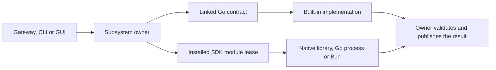

# Extension surface coverage

Magpie has several kinds of extension: built-in Go plugins, legacy provider
and gateway plugins, agent adapters, Library resources and installable SDK
modules. This census maps those surfaces to the current API 1.20 SDK and the
ordinary host owners. It distinguishes three layers:

- **Contract:** public descriptors, DTOs, method negotiation and validation.
- **Adapter:** an ordinary Magpie flow discovers and calls the module through
  the owning subsystem, with its scope, lifecycle and failure policy.
- **Domain module:** an actual provider, memory backend or agent implementation,
  with its own behavior, account correctness and migration evidence.

A complete contract or fixture is not a complete vendor migration. Companion
domain modules can share a repository under independently installable,
independently versioned `packages/`. Their source locks and acceptance records
remain separate from host acceptance; vendor logic stays outside the host.
`module.call`, checked file plans and private `state.cas` do not supply
missing adapters automatically.
The inventory below groups extension families; its rows are not a count of
SDK capabilities or an exhaustive operation list. The operation, modality
and transport matrix extends that inventory.

## Owner navigation and compatibility

The advertised API 1.20 ceiling does not change a module's negotiated minimum
or activate undeclared capabilities. Explicit API1.0 single-primary modules
remain supported; components require API1.1, private-tool exposure API1.2 and
later adapters retain the floors shown in their owning contracts.

| Surface or task | Current owning reference |
| --- | --- |
| Installation, native/exec/Bun selection, component configuration and lease lifetime | [Executable extensions](executable-extensions.md) |
| Go and JS author DTOs, negotiation and capability validation | [Go SDK](../../pkg/extension/README.md), [JS SDK](../../sdk/js/README.md) |
| Providers, selected accounts, auth state, models, paid tasks and usage | [Provider adapters](extension-providers.md) |
| One logical retry budget, bounded waiting and validated final refusal facts | [Shared request policy, API1.12](request-policy.md) |
| Local-owner tools and ordinary MCP/hub access | [Plugin tools](plugin-tools.md) and [private-tool boundary](#api-12-hooks-and-private-tool-boundary) |
| Search, rooted storage and session/agent adapters | [Search](extension-search.md), [storage](extension-storage-sources.md), [agents/sessions](extension-agents-sessions.md) |
| Owned foreground processes and agent-backed resume | [Process contract](extension-processes.md) |
| Current acceptance versus historical checkpoints | [ADR evidence index](../adr/README.md); final source-specific acceptance remains separately owned |

Request-policy adapters supply bounded vendor facts to existing routing,
budget and disposition owners. They grant no account selector or retry
scheduler and preserve accepted/output/uncertain replay fences.

With no installed SDK roots, SDK adapters start no module library, worker or
Bun process; Magpie retains its ordinary built-in owners. This is distinct
from the [legacy provider/plugin migration policy](provider-plugins.md).

The owner selects the implementation for each operation. For example, the
session owner selects a reader and controls the source path and publication.
A linked converter returns a document through `SessionConverter`. An
installed converter returns a document over `session.convert` while its
package generation is leased.

## Ordinary-entry adoption boundaries

Each module must adopt the ordinary entry it advertises. The following
checks identify source/authority boundaries; they are not current passing
results or live vendor evidence.

| Ordinary entry | Required module behavior | Owner and acceptance boundary |
| --- | --- | --- |
| MCP tools/list and tools/call | Publish schema-valid explicit account selection when needed; the host resolves and strips selection metadata before dispatch | [Tool owner](plugin-tools.md) enforces discovery/invocation exposure; [selected-account policy](extension-providers.md) also guards admission and revalidation after same-generation auth refusal. Schema conformance alone proves neither. |
| Usage refresh and account listing | Publish typed authentication refusal through the existing metadata owner | [Provider owner](extension-providers.md) binds reads/publication to package, configuration and credential generation. Historical quota must not erase an auth refusal; paid-task revocation has its own owner. |
| Native history resume and foreground process | Declare agent-backed resume and an owned foreground process | [Process owner](extension-processes.md) retains foreground, cwd, selected-account and cancellation authority. Installed package behavior and desktop attachment require separate evidence. |
| First-account GUI onboarding | Supply ordinary start/finish without manual scope or JSON editing | [Window auth owner](executable-extensions.md#window-integration) owns polling completion and private credential publication. A callback receiver, when needed, is module-owned; poll mode alone does not implement it. Rendered-browser and real sign-in acceptance remain separate. |
| Confirmed provider switches | Declare provider options and use the ordinary confirmation path | [Provider options](extension-providers.md) retain confirmation, CAS, cancellation, current selection and accounting authority. Each module must prove the resulting vendor request separately. |

These boundaries reuse existing subsystem owners. Optional built-in Memory,
masking, arbitrary CLI and pluginrt contribution adapters are not prerequisites
for every domain package. Package status, donor pins and module-entry evidence
belong to the companion repository and each package's source lock.

An external **memory domain module** is different from access to Magpie's
built-in shared Memory owner. API 1.2 gateway hooks and local-owner tools,
together with the existing private store/services and UI, let our module
implement its own memory: tool writes, recall for another agent, completed
exchange capture and durable private storage. It does not need the built-in
Memory API to be a memory module. Those hooks/tools plus the module's own
store supply the external memory slice. API 1.14 also offers optional
[scoped recall from built-in Memory](memory.md#sdk-tool-recall) to local-owner
SDK tools.

## Initial extension-family inventory

“Implemented” describes an actual SDK path, with its minimum API version.
“Partial” identifies an actual boundary. “Remaining” means no SDK adapter.
Data/resource imports already supported by Library are identified separately;
an optional SDK ownership binding is not a missing extension runtime.

| Type | Source evidence | SDK contract and actual adapter | Status / remaining boundary |
| --- | --- | --- | --- |
| Native / exec / Bun installation and distribution | [`native.Register`](../../pkg/extension/native/native.go), [`release.go`](../../internal/extension/release.go), [`release_auth.go`](../../internal/extension/release_auth.go), [explicit SDK1.0 native manifest](../../examples/extensions/echo-native/magpie-plugin.json) | Real native C ABI without author C glue; executable/Bun options; full-package hashes, private developer auth, pins/updates | **Implemented:** explicit API1.0 single-primary packages remain supported; composition requires API1.1. Runtime conformance does not imply vendor migration or identical platform proof. |
| Composite components, readiness, config and disposal | [`composite.go`](../../pkg/extension/composite.go), [`components.go`](../../internal/extension/components.go) | Primary + private exec/Bun services, DAG, readiness, root CAS snapshot, opaque local State, same-generation leases | **Implemented 1.1.** Services are private components, not cross-module pluginrt services. |
| Provider execution, models, account auth, quota/usage, operations | [`extension_provider.go`](../../internal/provider/extension_provider.go), [`extension_auth.go`](../../internal/provider/extension_auth.go), [`extension_transport.go`](../../internal/provider/extension_transport.go) | Ordinary owners use declared capabilities for execution, model discovery, refresh, usage and cancellation. API 1.19 adds the gateway's caller label and Remote Magpie hops. | **Implemented for declared operations.** The executing lease supplies caller metadata and scope. Arbitrary operations and full legacy-provider metadata parity remain outside it. |
| Legacy provider extras | [`Provider`](../../internal/plugin/providers.go), [`extension_calls.go`](../../internal/usage/extension_calls.go), [SDK provider adapters](extension-providers.md) | API 1.8 supplies check-in, idle auth renewal and distinct own-call/outside-history readers; API 1.9 adds declared provider switches and paid selected-account tasks with ordinary policy/accounting owners | **Implemented finite adapters through 1.9.** Auth renewal and paid cache work have separate declarations and accounting. Outside calls do not enter `Append` or notify live observers a second time. |
| Incoming protocols and response codecs | [`protocol_extensions.go`](../../internal/gateway/protocol_extensions.go), [`inbound.go`](../../pkg/extension/inbound.go) | Installed codecs enter ordinary guards/canonical dispatch and retain the primary lease; API 1.4 can require that exact lease's module for native-only execution | **Implemented through 1.4** for negotiated canonical operations; not arbitrary gateway route registration or vendor receipt validation. |
| Plugin tools / MCP tools | [`extension_tools.go`](../../internal/plugin/extension_tools.go), [`extension_tools.go`](../../internal/gateway/extension_tools.go) | `tool-provider` enters ordinary plugin-tools MCP/hub; API 1.2 adds shared/local-owner exposure | **Implemented through 1.2.** Discovery and actual leased invocation enforce local-owner authority, including after package replacement. |
| MCP server configuration and protocol integration | [`Server`](../../internal/library/mcp.go), [`ServeRun`](../../internal/library/mcp_run.go) | Library already supports configured servers, prompts/resources/templates and protocol notifications; SDK declares tools | **Existing data/protocol integration.** Automatic ownership binding of a module's MCP service is not supplied, but this is not an unimplemented extension runtime. |
| Ordinary agent wiring | [`extensionAgents`](../../internal/agent/extension_actions.go), [`AgentDescriptor`](../../pkg/extension/contract.go) | Rich descriptors reach ordinary discovery, inspect/connect/set/disconnect and checked plans | **Implemented:** configuration wiring accepts explicit API1.0 descriptors; declared launch requires API1.5. Ordinary discovery requires ConfigFiles or a declared launch; ID/Name-only descriptors remain manual actions. |
| Agent launch / aliases / WSL / own-model metadata | [`agent_metadata.go`](../../pkg/extension/agent_metadata.go), [`agent_model_metadata.go`](../../pkg/extension/agent_model_metadata.go), [`extension_controller.go`](../../internal/agent/extension_controller.go) | SDK 1.5 declares aliases, UA, structured launch, config placeholders and explicit local profiles; API 1.9 projects effective max output, effort knowledge and default effort through ordinary inspect/plan | **Implemented 1.5 local launch / 1.9 model metadata.** An SDK profile cannot adopt another SDK profile or a WSL target. Older SDK agent options retain their earlier wire. |
| Library target of an SDK agent | [`pluginTarget`](../../internal/library/targets.go), [`extensionAgent`](../../internal/agent/extension_actions.go) | SDK 1.5 typed Library metadata reuses instructions/MCP/skills owners; active profiles inherit the canonical base target | **Implemented 1.5.** Resource selection, application and removal use the same target identity; unrelated user content remains owned by the user. |
| Session document conversion | [`extension_actions.go`](../../internal/sessions/extension_actions.go), [`extension_source_inputs.go`](../../internal/sessions/extension_source_inputs.go) | `session.convert`, checked output plans and ordinary CarryOver routes; optional read action `session.inputs.v1` acquires checked journal/blob inputs under one lease | **Implemented through 1.3.** Selected-store/file/parent snapshots and target-store guards protect ordinary application; deferred explicit callers retain source-validation responsibility. |
| Linked transcript decoding | [Native readers](extension-agents-sessions.md#api-16-jsonl-session-sources), [`SessionTreeCodec`](../../pkg/extension/session_tree.go) | Ordinary Claude and Codex readers emit the shared session part DTO. Pi, OMP, Raft and Cindy use the linked tree codec for transcript records and indexing. | **Linked Go contracts.** File access, ancestry, offsets and consent stay in the session owner. |
| Session source / discovery / reader / resume | [`extension_source_registry.go`](../../internal/sessions/extension_source_registry.go), [`extension_source_adapter.go`](../../internal/sessions/extension_source_adapter.go), [rooted storage sources](extension-storage-sources.md) | SDK 1.6 declares finite JSONL layouts; API 1.8 native storage readers retain host consent and module-owned schemas; API 1.9 preserves descendant acquisition and exact child identities | **Implemented declared source adapters.** Linux/Darwin descriptor-rooted source is distinct from remote/compressed stores or arbitrary launchers. Native ownership requires an explicit checked binding; Darwin runtime proof remains separate from cross-builds. |
| Native agent account/bootstrap operations | [`account_operations.go`](../../pkg/extension/account_operations.go), [`protocol_account_operation.go`](../../internal/gateway/protocol_account_operation.go) | SDK 1.6 and codec 0.5 bind declared read/write actions to the original inbound module, current owned agent, explicit visible model and exact account generation | **Implemented 1.6 local-owner adapter.** No arbitrary routes, remote credential delegation or routing-group account selection. |
| Synchronous gateway middleware | [`SDK adapter`](../../internal/gateway/extension_middleware.go), [`middleware contract`](../../pkg/extension/middleware.go), [`owner reference`](gateway-middleware.md#installable-sdk-middleware-api-18) | Explicit root `gateway-middleware` joins ordinary request/account/provider/event/response points with per-request state, read-only checked leases and protected request fields | **Implemented 1.8; scoped synthetic owner verification.** Separate from asynchronous request recall and ledger observation. Synthetic owner fixtures do not establish live community-package compatibility. |
| Asynchronous request / completed-response / sign-in hooks | [`GatewayBegin`, `GatewayRun`, `GatewaySignIn`](../../internal/plugin/gateway.go), [`hooks.go`](../../pkg/extension/hooks.go) | API 1.2 `gateway-hooks` enters ordinary request/completion/sign-in owners with origin, effect and lease checks | **Implemented 1.2, scoped host proof.** Recall is read-only; capture keeps the selected generation and durable effect policy. This is not synchronous middleware or built-in Memory access. |
| Global request/attempt/ledger observation | [`Observer`, `Watch`](../../internal/usage/observe.go), [request and ledger adapters](gateway-request-hooks.md#sdk-request-lifecycle-observation) | API 1.8 `ledger-observer` joins ordinary `Append`. API 1.12 `request-observer` joins the gateway's start, attempt and end callbacks. Each uses a bounded asynchronous metadata queue. | **Implemented through 1.12.** Existing usage and OTLP owners retain delivery. The SDK observers receive no bodies and cannot modify requests or ledger rows. `usage-reporter` supplies provider-specific history. |
| Routing strategy / seat ordering | [`LinkedRoutingStrategy`](../../pkg/extension/linked_routing.go), [`RoutingStrategyDescriptor`](../../pkg/extension/routing.go), [`Manager.OrderRouting`](../../internal/extension/routing.go) | Rotation declares linked strategies with its feature. Installed modules use namespaced READ actions owned by the primary or a private service. Both enter ordinary provider/group ordering. | **Linked Go and installable 1.4 adapters.** The owner checks permutations and retains identity fallback. Installed actions also require current revision/config leases and bounded wire inputs. [Installed adapter record](../adr/0012-sdk-routing-strategies.md). |
| Budget limiter / spender | [`LinkedBudgetLimiter`, `LinkedBudgetSpender`](../../pkg/extension/linked_gateway.go), [SDK budget policy](plugin-runtime.md#executable-budget-policy) | The linked feature declares its limiter for the authenticated caller type. API 1.13 supplies selected `budget.reserve` and `budget.spent` policies with bounded metadata. | **Linked Go and installable 1.13 adapters.** The built-in owner retains reservations, accounting and issuer constraints. Policy errors on budgeted calls fail closed. |
| Reversible masking | [`Masker`](../../internal/gwmw/gwmw.go), [`plugins/redact`](../../plugins/redact/redact.go), [SDK rule sets](plugin-runtime.md#executable-masking-rules) | API 1.15 lets the gateway owner select declarative rules from one enabled package. The built-in masking engine keeps authority over the request and the reversible store. | **Implemented 1.15 for bounded declarative rules.** Selection is checked on ordinary masked routes, relays and Realtime. |
| Search source / gateway web search | [`searchesOf`](../../internal/plugin/host.js), [`SDK search sources`](extension-search.md), [`gwtool`](../../internal/gwtool/gwtool.go) | Legacy search hooks and the ordinary search owner, Settings selection, account order, proxy and search ledger | **Implemented 1.8:** explicit `searchSources` with declared primary read actions; a tool named search remains separate. Scoped synthetic source acceptance does not claim live community-package compatibility. |
| Built-in shared Memory / scoped CRUD / digest | [`memoryMCPCall`](../../internal/gateway/memory_mcp.go), [`MemoryOwner`](../../pkg/extension/memory_owner.go), [`Digest`](../../internal/memory/digest.go) | Ordinary GUI, MCP and maintenance paths use the linked Memory contracts. API 1.14 local-owner tool recall uses the caller/project/agent resolver and read-only ranking. | **Linked Go operations and installable scoped recall.** Memory owns checked writes and digest publication. Library owns instruction files. Installed modules have no built-in Memory write grant. |
| Semantic Memory / Distillation / Dream | [`MemorySemanticService`](../../pkg/extension/memory_semantic.go), [`MemoryDistillationService`](../../pkg/extension/memory_distillation.go) | Window controls and backend keepers use the linked services. Semantic ranking receives scoped records. Its progress and index use the same Memory snapshot. Distillation and Dream use the bound gateway callback and linked prompt/reply codec. | **Linked Go contracts.** The host resolves model access and accounting. Memory and the linked services keep cancellation, suggestion validation and checked publication. |
| Library resources and optional module contributions | [`Library`](../../internal/library/library.go), [SDK rules and commands](library.md#sdk-rule-import), [`Hook`](../../internal/library/hooks.go), [`Subagent`](../../internal/library/subagents.go), [`EnvVar`](../../internal/library/env.go) | Instructions, skills, agent hooks, env and subagents have apply/remove owners. Rules and slash commands can also be imported explicitly from enabled SDK modules. | **SDK 1.17 rules and 1.18 commands.** Imports copy the selected revision into the user's Library. The Library retains reconciliation and file ownership. |
| Library sources and imported packages | [`Source`](../../internal/library/skills.go), [`Claude bundles`](../../internal/library/plugin.go), [`Pi management`](../../internal/library/piext.go) | GitHub/Git/folder sources and imported resources retain their existing owners | **Existing import category.** Skills/bundles/Pi package management are not unimplemented SDK runtimes; automatic SDK package/resource lifecycle binding would be a separate feature. |
| Window pages / panels / replacements / row actions | [`windowmeta`](../../internal/windowmeta/window.go), [`extension_window.go`](../../internal/gui/extension_window.go), [`window_auth.go`](../../internal/extension/window_auth.go) | Existing renderer and metadata; named action/service bindings; API 1.5 adds exact selected-account action grants and independent host-owned polling authentication grants | **Implemented 1.1 / scoped 1.5.** Combined acceptance remains separate; callbacks, key import and account-bound tools are not supplied by this window adapter. Adjacent assets alone do not register a window. |
| Other browser bridge functions | [`pagebridge.js`](../../internal/gui/pagebridge.js), [`ui.d.ts`](../../sdk/js/ui.d.ts) | Browser-only typed entry delegates theme/context/visibility events, actions, permission-checked reads and PNG operations as well as ready/service/backend/config | **Implemented facade.** Actual page bridge exercised in a VM fixture; native clipboard/download and the full browser matrix remain separate verification. |
| Built-in feature activation, settings and UI slots | [`FeatureContribution`](../../pkg/extension/feature_contribution.go), [`RegisterFeature`](../../internal/pluginrt/feature.go), [`module_settings.go`](../../internal/extension/module_settings.go), [`kernel.js`](../../internal/gui/assets/kernel.js) | Linked features declare identity, dependencies, activation, slots, settings and links. Installable modules declare settings over their root config CAS and UI over package window metadata. | **Linked Go and installable 1.16 settings adapters.** The built-in registry owns reconciliation and the GUI owns rendering. |
| pluginrt registry / InUse / Requires / Provides | [`Manifest`, `Ctx`, `Runtime.Reconcile`](../../internal/pluginrt/pluginrt.go) | The compile-time Go registry owns activation and disposal of linked feature contributions and service dependencies. | **Partial:** installable SDK contributions have no general pluginrt service registry. Private sidecars are owned by their root package. |
| Headless/background activation | [`Module.Start`](../../pkg/extension/lifecycle.go), [`preparePrimary`](../../internal/extension/components.go), [`AccountTasks`](../../internal/extension/account_tasks.go) | Startup/dispose and eager/lazy services; API 1.8 gateway activation/auth renewal; API 1.9 scoped paid task scheduling | **Implemented finite lifecycle owners.** Arbitrary app-wide jobs and cross-module scheduler registration are outside these declarations. |
| CLI command registration | [`sdkPluginRun`](../../internal/cli/sdk_cli.go), [`main.go`](../../internal/cli/main.go) | Manual SDK call/plan/config/lifecycle commands exist | **Partial:** modules cannot register arbitrary top-level commands/flags. |

## Provider operations, modalities and transports

The canonical protocol enum is not a complete provider-operation inventory.
[`Protocol`](../../pkg/protocolext/inbound.go) names four conversational
families: Chat, Responses, Messages/Anthropic and Gemini, plus Models/Tool
inbound operations. Image generation, transcription or token counting can
be operations within or beside those families.

Legacy [`pluginFetch`](../../internal/provider/plugins.go) retains HTTP
method/path/body and uses the selected plugin account. SDK API 1.3 separately
declares conversational `protocols` and a finite provider `operations` list.
[`extension_operations.go`](../../internal/provider/extension_operations.go)
matches exact method/path pairs; both the actual leased manifest and the
author SDK reject undeclared operations before dispatch. Selected upstream
bytes, content type, method/path/query and API 1.3 escaped path reach the
module through `ExecuteRequest` and typed `ExecuteOptions`.
The registry adds no arbitrary URL handler or public gateway route.
See [ADR 0008](../adr/0008-provider-operation-contracts.md).

| Operation / metadata / transport | Existing upstream or legacy path | SDK contract and actual adapter | Evidence / boundary |
| --- | --- | --- | --- |
| Multimodal conversation input | [`plugin.Model.Inputs/Outputs`](../../internal/plugin/providers.go), copied by [`serves`](../../internal/provider/plugins.go), includes image/audio/video/pdf | API 1.3 [`Model`](../../pkg/extension/types.go) declares kind, input/output modalities, default/maximum context, temperature, release, tiers, rates and reasoning defaults; ordinary projection retains them | **Implemented 1.3 metadata.** Nil/unknown and explicit empty modality lists stay distinct. Metadata grants no transport permission; legacy fields outside this DTO remain gaps. |
| Image generation / edits | [Ordinary image selection](../../internal/gateway/draw.go) supports OpenAI-compatible image routes and Gemini image generation | API 1.3 `images.generate`/`images.edit` declarations admit the corresponding exact upstream requests; image kinds/output modalities enter ordinary selection | **Implemented finite operation adapter.** Modules supply vendor execution. Gemini generateContent remains its native protocol path; no universal image codec or live-vendor parity is implied. |
| Audio transcription / translation / speech | [`transcribe`](../../internal/gateway/transcribe.go), [`speech`](../../internal/gateway/speech.go), [`retrieveOpen`](../../internal/gateway/embeddings.go) retain ordinary caller/signing/transport owners | API 1.3 `audio.transcribe`, `audio.translate`, `audio.speech` carry selected multipart/binary/streaming requests and model kinds | **Implemented declared upstream operations.** The registry does not create additional public audio routes or implement a vendor's audio service. |
| Video create / status / content | [`customVideomakersOf`, `keyMark`, `markedKey`](../../internal/gateway/video.go) select video models and retain result ownership | API 1.3 `videos.create/get/content/delete/remix`; stable module/provider/account marks bind continuations across credential refresh | **Implemented finite operation/account adapter.** Switching accounts cannot take over a video; vendor status/cancel semantics still belong to the module. |
| Embeddings / rerank | [`retrieve`, `retrieveOpen`](../../internal/gateway/embeddings.go) send selected requests through provider signing/transport | API 1.3 `embeddings`/`rerank`, projected model kinds and declared-operation checks enter ordinary retrieval | **Implemented finite operation adapter.** Accepted/uncertain/completed work cannot automatically fall through to another account/provider. |
| Anthropic token counting | [`countOn`](../../internal/gateway/gateway.go) forwards `/v1/messages/count_tokens` when supported and otherwise may estimate | The SDK messages-path branch accepts that path as Anthropic and preserves it in `Options.path` | **Implemented with an ordinary gateway fixture.** [`TestSDKMessagesCountPreservesToolHistory`](../../internal/gateway/extension_messages_body_test.go) checks the exact path, unmodified tool history and returned count from the installed worker. |
| Dedicated decision models versus ordinary classifiers | [`extension_decisions.go`](../../internal/provider/extension_decisions.go), [`decisions_systemone.go`](../../internal/gateway/decisions_systemone.go), [`classify.go`](../../internal/gateway/classify.go) | API 1.7 explicitly declares `systemone` models and operation; ordinary System One/classifier owners retain account selection, normalized accounting and acceptance fences | **Implemented 1.7 finite adapter.** Decision-only models are excluded from conversational catalogs. Direct OpenAI Decisions eligibility remains its own contract. |
| Core Realtime WebSocket | [`realtime`](../../internal/gateway/realtime.go) owns `/v1/realtime` and `/realtime`, provider sign-in, account restrictions and bidirectional frames | Go/JS manifests and the runtime reserve this core namespace; SDK provider operations do not declare a Realtime executor | **Core adapter only.** Importing upstream Realtime support does not add an SDK raw-socket contract or make the six modules Realtime providers. |
| Client Responses WebSocket | [`responsesSocket.turn`](../../internal/gateway/responses_ws.go) turns a socket frame into the ordinary POST handler path | That shared path can route to an SDK Responses provider; no SDK raw-socket callback is declared | **Indirect integration in source.** This census did not execute a WebSocket + SDK-provider fixture; no blanket unsupported or full parity claim. |
| Window service WebSocket | [`servePageServiceTarget`](../../internal/gui/pageservice.go), [`serveExtensionWindowService`, `verifyWindowServiceProof`](../../internal/gui/extension_window_service.go) support upgrade handling, retain duplex bodies and hold the response lease | Composite UI uses this existing HTTP/SSE/WebSocket service adapter with component proof | **Implemented adapter path.** WebSocket service transport must not be confused with a provider protocol or ModuleRPC streaming. |
| Module-owned upstream sockets | Legacy provider implementations own vendor I/O behind their fetch; exec/native/Bun SDK implementations likewise own their networking | [`network.proxy`](../../pkg/extension/README.md) resolves policy for HTTP(S)/WS(S), but is not a host socket-dial API | **Networking implementation choice.** No separate public provider-WebSocket registration point was established by this bounded source inspection. |

The API 1.3 media/retrieval fixture is
[`extension_media_test.go`](../../internal/gateway/extension_media_test.go);
provider transport/catalog tests and
[`provider_operation_admission_test.go`](../../internal/extension/provider_operation_admission_test.go)
cover raw bytes and actual leased-generation admission. These are scoped
synthetic proofs, not live implementations of every declared vendor operation.
Arbitrary endpoints and the remaining extras in the inventory are separate
work; dedicated System One decisions have their API 1.7 adapter.

The browser extension is another boundary:
[`browserext`](../../internal/browserext/browserext.go) packages a companion
client for the gateway's browser relay. It is not an installable SDK runtime.
Likewise, the legacy [Pi provider adapter](../../internal/plugin/pi.js) uses
Pi providers but deliberately leaves Pi session commands/tools/renderers/event
handlers unused; those are not already-supported Magpie hooks waiting for
a transport change.

The domain-memory fixture
[`TestGatewayHooksMemorySharesDurableStoreWithTools`](../../internal/extension/gateway_hooks_test.go)
exercises tool write,
another agent's recall, completed-response capture and reopening the same
private store after Manager restart. That is evidence for an external
module's own memory flow, not built-in Memory CRUD/digest integration.
The [API 1.2 validation record](../adr/0006-gateway-hooks-validation.md)
records its host evidence; the existence of a source fixture alone is not
a passing gate for a different tree.

## API 1.2 hooks and private-tool boundary

The authoritative public contract is
[`pkg/extension/hooks.go`](../../pkg/extension/hooks.go), with matching JS
declarations in [`sdk/js`](../../sdk/js/index.d.ts). Gateway hooks are primary
methods, unary, without selected-provider/account/auth scope. Request is read;
response/sign-in are write and may emit an acknowledged acceptance receipt.
State is at most 64 KiB of JSON. Origins default to local and magpie-key;
the five SDK origins are local, magpie-key, gateway-key, remote and browser.
Browser is explicit opt-in: a loopback page is not treated as default local
recall/capture authority, even with the default key. Legacy hooks retain
their existing four-origin semantics. Sign-in still requires local permission.
These constraints do not turn
hooks into a Memory owner API, stream middleware or global observer.

The host's read-only request marker denies `state.cas` from recall.
Response/sign-in writes use the root operation's durable acceptance and
no-replay rules. Those checks belong to the runtime/gateway owner tests;
JS fixtures that acknowledge a write or return a host refusal do not prove
the real host marker or journal behavior.

API 1.2 tool exposure distinguishes shared and local-owner. Descriptor
validation and public projection are SDK responsibilities; deciding which
ordinary MCP/hub callers may discover or invoke a local-owner tool belongs
to the host adapter. A JS unit test cannot prove those host access paths.
The [owner validation](../adr/0006-gateway-hooks-validation.md) includes these
host checks; JS conformance alone must not be substituted for them.

## API 1.3 account and session boundaries

[ADR 0007](../adr/0007-transactional-account-refresh.md) defines the host-owned
refresh transaction: strict per-account OS ownership, a durable dispatch
fence, one unary exchange, atomic credentials/expiry/generation/receipt
publication, and an uncertain fence after an ambiguous result. API 1.3
ordinary provider preflight renews known near-expiry credentials. It accepts
only a receipt-proven refresh successor of a cached account; manual
replacement or deletion remains stale. A module lock or state CAS is not
that transaction, and no unseen rotated token is recoverable after a crash.

The session adapter's `session.inputs.v1` action plans additional source
files. The host chooses the selected native store, checks paths/digests and
bounded inputs, retains planner/converter on one lease, and rechecks source
file, permission, parent-directory and store identities before ordinary
application. This enables attachment-aware native OMP conversion through
existing readers/resume owners; it is not generic SDK reader registration.
Explicit callers retaining an output plan still own deferred source checks.

## Remaining owner adapters

Use common declaration/lifecycle machinery with typed subsystem adapters,
rather than a new capability for every feature or an unrestricted host RPC.
The following are proposed owner integrations, not additional negotiated
fields. Existing selected-account window bindings, polling auth, agent
launch/profile handoff, declared session sources and finite background
lifecycles keep their own adapters; they do not supply these other grants.
Agent/profile collisions still require explicit adoption. Additional history
transports need their own checked readers.

The [owner contribution registry](executable-extensions.md#owner-contribution-registry)
resolves versioned search and routing actions and their earlier declarations.
The Library consumes static rule and command declarations through explicit import.
Additional action points require a typed owner adapter. Original primary
capability methods retain their owners and ModuleRPC remains unary.

Additional history transports, other declarative Library resources and arbitrary
app-wide jobs need their own checked adapters. Declared gateway activation,
auth renewal and paid tasks retain their finite owners.

The implemented memory slice includes gateway hooks, local-owner tools,
module-owned storage and scoped recall from built-in Memory. Linked Go
contracts cover digest rendering and assembly, semantic ranking, index
input, and model I/O for Distillation and Dream. Memory owns checked
mutations and digest persistence. Library owns instruction writes.
Routing, observation, budget and masking have different timing and failure
contracts. Budget policy enters the built-in reserve and spent owners.
The masking owner selects bounded declarative SDK rules under API 1.15.

## Logging and collection boundaries

SDK provider execution and decoded native inference enter the ordinary
gateway attempt, usage ledger, Watch and OTLP owners. Terminal failures
retain their measured usage. Own background calls use `usage.Append`;
outside-account history uses `IngestReported` with its separate dedup and
observer policy. Paid-task cancellation flushes the last measured facts
once. Structured module diagnostics use host-derived scope and the existing
host logger, rejecting forged, stale or excessive messages.

The owner regressions include
`TestExtensionTerminalAttemptsReachWatchAndLedger`,
`TestSDKOwnCallUsesAppendWhileOutsideHistoryUsesIngestReported`,
`TestExtensionAccountTaskCancellationKeepsLastMeasuredFactsOnce` and
`TestModuleDiagnosticsReachTheExistingHostWithSelectedAuthority`.
The [validation record](../adr/0027-sdk19-upstream-module-validation.md)
keeps their ordinary-owner, installed-module and historical source pins
separate.

This preserves Magpie's collection semantics, not a lossless raw transport
recorder. Archive sees canonical input after native decode; it does not
archive every native protobuf or background HTTP body. OTLP does not project
every ACU amount/currency, native ID or tier stored in the ledger. Diagnostic
rate limits and bounded archive/export queues remain. Whether a domain
module adopts an own-call or outside-history reader belongs to its source
lock and package evidence, not to the presence of the host contract.

## Evidence and limits

Use the [ADR evidence index](../adr/README.md) for decisions, historical
checkpoints, original failures and their exact source/environment limits.
In particular, the
[native/composite record](../adr/0005-native-composite-validation.md) and
[gateway-hook record](../adr/0006-gateway-hooks-validation.md) preserve their
separate historical matrices. Neither transfers acceptance to a later tree.
The [runtime reference](executable-extensions.md) and
[comparison](extension-runtime-comparison.md) describe transport boundaries.

The [hook tests](../../sdk/js/test/gateway-hooks.test.js) include browser
default-deny/explicit opt-in, credential-scope refusal, exact original-wire
state bounds and unary effects. The
[real process checks](../../sdk/js/test/gateway-process.test.js) use Node/Bun
children with fixture host state; they do not prove ordinary gateway routing,
local-owner tool filtering or a durable Go Memory owner.
Refresh/operation/source-input checks belong to their ordinary owners;
[ADR 0007](../adr/0007-transactional-account-refresh.md) and
[ADR 0008](../adr/0008-provider-operation-contracts.md) retain the decision
rationale. Module-entry acceptance needs each package's exact source and
host binding, in addition to public/server conformance.

A new acceptance packet must identify its source, declared matrix, terminal
results, source-after and owned-process closure. This census asserts no new
full-repository green, benchmark, rendered-browser, native-platform or live
vendor result and does not turn remaining rows into SDK adapters.
